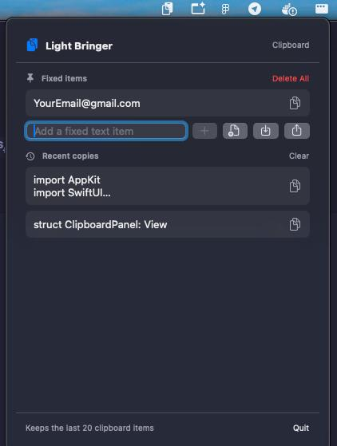

# Light Bringer

A small native macOS menu-bar clipboard utility built with SwiftUI.

## Preview



## Features

- Fixed, reusable text snippets and file selections
- Import and export fixed text presets as a JSON array
- The 20 most recent unique text or file clipboard items
- Click any item to copy it
- The menu-bar icon briefly turns into a check mark when you copy from the quick menu
- Right-click an item to pin or delete it
- Right-click the menu-bar icon for the first 20 fixed and 5 most recent items; click one to copy it
- Option + right-click or Command + right-click anywhere on screen opens the same menu at the cursor (asks for Accessibility permission)
- Local persistence with `UserDefaults`
- Menu-bar-only interface

## Requirements

- macOS 13 or newer
- Xcode 15 or newer

## Run

Open `Package.swift` in Xcode and run the **LightBringer** scheme, or use:

```sh
swift run LightBringer
```

The clipboard history is stored locally in the app's user defaults. Plain text up to 20,000 characters and copied file references are recorded.

### Fixed-item preset format

Use the import button to choose a `.json` file containing an array of strings, or use the export button to create one:

```json
[
  "Thanks!",
  "I'll get back to you shortly."
]
```

Imported items are merged with existing fixed items; duplicates are skipped. Export includes fixed text items only, because file references are machine-specific.

### Quick menu

Right-click the menu-bar icon, or hold **Option** or **Command** and right-click anywhere on screen, to open a menu with the first 20 fixed items and the 5 most recent copies. Click an item to copy it; the menu-bar icon turns into a check mark for a second to confirm.

Option or Command + right-click needs the Accessibility permission so Light Bringer can intercept that click (plain right-clicks are never touched). Grant it in System Settings → Privacy & Security → Accessibility. Because the app is ad-hoc signed, macOS may reset the permission after a rebuild; remove and re-add Light Bringer in that list if the shortcut stops working.

## Build and install the app

```sh
chmod +x scripts/build-app.sh
./scripts/build-app.sh --install
open "/Applications/Light Bringer.app"
```

The script creates a release build, packages it as `dist/Light Bringer.app`, ad-hoc signs it for this Mac, and copies it to `/Applications`.

## Download

Grab the latest `LightBringer-<version>.dmg` from the [Releases](https://github.com/AliusDieMorietur/light-bringer/releases) page, open it, and drag **Light Bringer** into **Applications**.

The app is ad-hoc signed, not notarized, so macOS blocks the first launch. Right-click the app and choose **Open**, or allow it in System Settings → Privacy & Security.

To build the DMG yourself:

```sh
./scripts/build-dmg.sh   # creates dist/LightBringer-<version>.dmg
```
